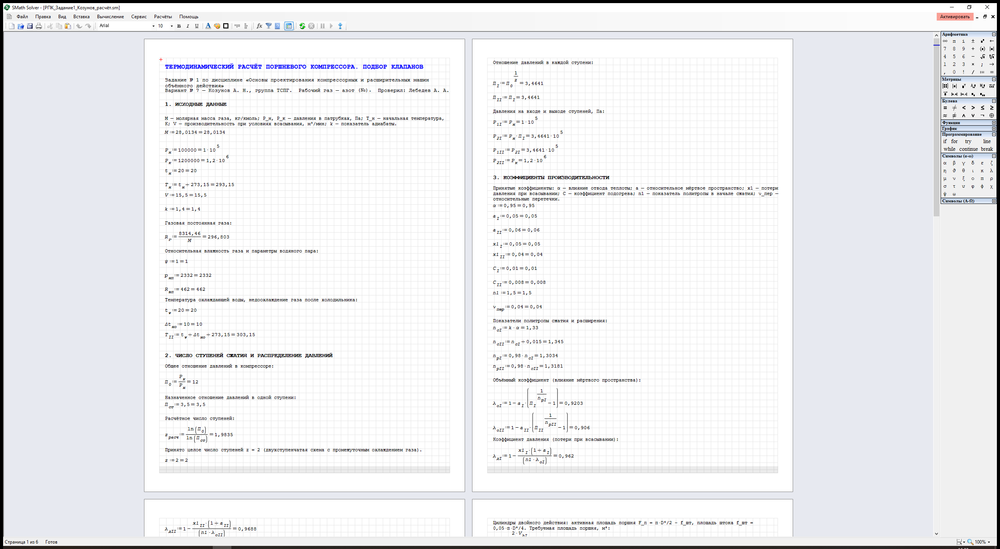
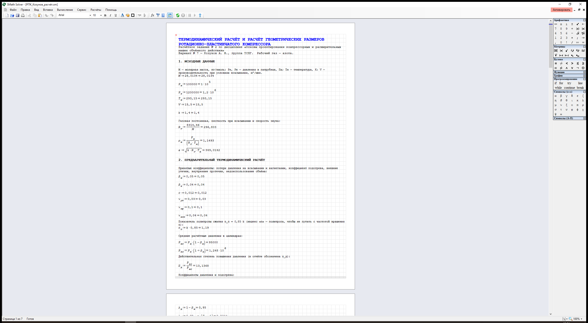

# smath-worksheets

Agent skill for generating **SMath Studio** worksheets (`.sm`) that actually open,
compute and look right — verified against SMath Studio 1.5.0.9678.

Скилл для агента (DeepSeek Harness / Claude Code / любой системы со `SKILL.md`):
генерация рабочих таблиц SMath Studio с формулами, русскими комментариями и
видимыми результатами.

## Зачем это нужно

Наивная генерация `.sm` даёт файл, который SMath открывает с ошибкой
«Ссылка на объект не указывает на экземпляр объекта», либо файл открывается, но:

* переменные с индексами подсвечены **красным** (`el(x, i)` — это элемент
  массива, а не подстрочный индекс);
* у определений не видно **значений** — только формулы;
* текстовые блоки и дроби **налезают** друг на друга.

Этот репозиторий содержит готовую библиотеку, которая всё это учитывает, и
скрипты проверки, которые открывают файл в настоящем SMath и снимают скриншот.

## Что внутри

| Путь | Назначение |
|---|---|
| `SKILL.md` | сам скилл: 4 правила, шаблон файла, рабочий процесс, ловушки |
| `lib/smscript.py` | генератор листа: `Doc`, `Flow`, выражения, запись формата 0.88 |
| `lib/smread.py` | независимый парсер и вычислитель `.sm` (сверка значений без GUI) |
| `scripts/check_open.py` | открыть `.sm` в SMath и отличить «ОК» от диалога ошибки |
| `scripts/screenshot.py` | открыть, развернуть окно, снять скриншот (визуальная проверка) |
| `references/format-notes.md` | разбор XML-формата: регионы, RPN-токены, ограничения |
| `examples/minimal.py`, `examples/minimal.sm` | минимальный рабочий лист |

## Установка

```powershell
python install.py                 # в C:\Users\<вы>\.dsh\skills\smath-worksheets
python install.py --target "C:\путь\.dsh\skills"
```

Скопировать вручную тоже можно: нужна папка `smath-worksheets` с `SKILL.md`
внутри одного из корней скиллов (`~/.dsh/skills`, `<project>/.dsh/skills`, …).

## Быстрый старт

```python
import sys; sys.path.insert(0, r"<repo>/lib")
from smscript import Doc, V, num, sqrt

doc = Doc(font_size=10, title="Расчёт", author="Студент")
f = doc.flow(left=9, top=9, width=700, gap=3, font_size=10)
f.title("ТЕРМОДИНАМИЧЕСКИЙ РАСЧЁТ")
f.text("1. ИСХОДНЫЕ ДАННЫЕ", bold=True)
f.assign(V("P", "н"), num(100000))        # P.н := 100000 = 1·10⁵
f.assign(V("a"), sqrt(num(1.4) * num(296.8) * num(293.15)))
doc.save("расчёт.sm")
```

```powershell
python scripts/check_open.py "расчёт.sm"          # ОК / текст ошибки
python scripts/screenshot.py "расчёт.sm" "shot.png"
```

## Как это выглядит

Рабочие листы, сгенерированные этой библиотекой (SMath Studio 1.5, все переменные
определены, справа видны значения):

| Задание № 1 — поршневой компрессор | Задание № 2 — ротационно-пластинчатый |
|---|---|
|  |  |

## Технические требования

* Windows (SMath Studio — WinForms-приложение), установленный SMath Studio
  (`C:\Program Files (x86)\SMath Studio\SMathStudio_Desktop.exe`).
* Python 3.10+, `pywin32`, `Pillow` — только для скриптов проверки; сама
  библиотека `lib/smscript.py` зависимостей не имеет (стандартная библиотека).

## Ключевые факты формата (коротко)

1. Шапка и `<settings>` — формат **0.88** (`progid="SMath Studio" version="0.88"`).
   Схема 1.0 с `SMath Studio Desktop 1.5.0.9678` роняет SMath 1.5.
2. Подстрочный индекс — точка в имени: `<e type="operand">V.ут</e>`.
3. Определение показывает значение только при `<result action="numeric">`.
4. Высота области: текст — с учётом переноса, формулы — с учётом двухэтажных дробей.

Подробности — в `SKILL.md` и `references/format-notes.md`.

## Лицензия

MIT — см. `LICENSE`.
